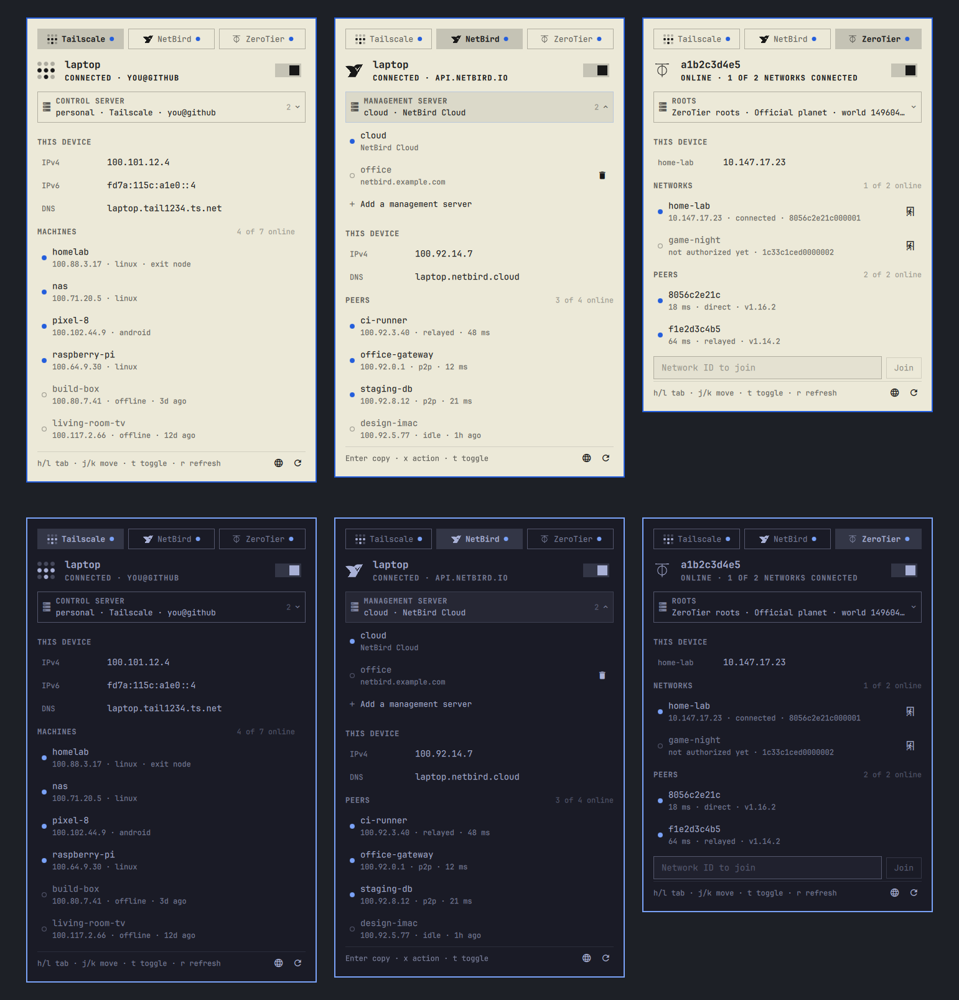

# Tunnels

Tailscale, NetBird and ZeroTier behind one Omarchy bar icon and one tabbed
panel. Each installed VPN gets a tab; switch between official and
self-hosted servers (Headscale, self-hosted NetBird, ZeroTier moons) without
leaving the bar.



*Top: Windows XP theme, bar at the bottom. Bottom: Tokyo Night, bar at the
top. Both use demo mode's sample data.*

*Unofficial. Not affiliated with or endorsed by Tailscale Inc., NetBird
GmbH, or ZeroTier Inc.; their marks belong to them and are used here only
to tell the tabs apart.*

## Install

```bash
omarchy plugin add https://github.com/fahmikemal/omarchy-tunnels.git --enable
```

The widget lands in the bar's right section. Move it with
`omarchy bar move io.github.fahmikemal.tunnels --section center`.

A VPN gets a tab only when its CLI is on `PATH`; with none installed the icon
leaves the bar. Detection reruns every two minutes, so installing or removing
a VPN adds or drops its tab without restarting the shell.

## Requirements

| What | Needed for |
|---|---|
| `tailscale`, `netbird`, `zerotier-cli` | Whichever VPNs you use; each is optional |
| `wl-copy` (wl-clipboard) | Copying addresses |
| `curl`, `jq`, `secret-tool` (libsecret) and a running keyring | The ZeroTier tab |
| polkit (Omarchy's shell agent) | The one-time grants and starting or stopping services, below |

## Privileges

The plugin runs as your user. It asks for more only through polkit, and only
when you press the button that needs it:

- **ZeroTier "Grant access"** runs `pkexec cat /var/lib/zerotier-one/authtoken.secret`
  and stores the token in your keyring (`secret-tool`, service
  `omarchy-tunnels`, user `zerotier`). `bin/zt-api` reads it from there and
  passes it to `curl` on stdin, never in argv, and only to `127.0.0.1`.
- **Tailscale "Allow"** (shown when your user is not Tailscale's operator)
  runs `pkexec tailscale set --operator=$USER`.
- **Start service / the ZeroTier switch** run `systemctl start|stop` on
  `tailscaled`, `netbird` or `zerotier-one`; systemd asks polkit itself.

Sign-in links printed by `tailscale up`, `tailscale login` and
`netbird up --no-browser` open with `omarchy-launch-browser`.

## Panel

- **Tabs** — one per installed VPN, with a dot: filled = connected, ring = off,
  urgent = needs you. Narrow screens drop the names and keep the marks.
- **Hero** — this device's name, the connection state, and a switch. For
  Tailscale and NetBird the switch is `up` / `down`; for ZeroTier it is the
  `zerotier-one` service.
- **Notice** — only when something needs you: sign in, start the service,
  grant access, approval pending, or an error, each with its button.
- **Server** — the control plane this VPN signs into; open it to switch,
  remove, or add one (see below).
- **This device** — this machine's addresses. Click to copy.
- **Machines / Peers / Networks** — online first; click a row to copy its
  address. A filter appears once a list passes eight rows. ZeroTier networks
  have a leave button and a field to join a network by ID.

Only the list scrolls; tabs, hero, server and filter stay put.

## Servers: official or self-hosted

Clicking another server switches to it, and the trash button removes one;
both take two presses, since switching drops the current connection. "Add"
offers the official service or a self-hosted URL.

| VPN | A server is | Switch | Add |
|---|---|---|---|
| Tailscale | an account (`tailscale switch --list`) | `tailscale switch <id>` | `tailscale login --login-server=<url> [--nickname=<name>]`: Tailscale or Headscale |
| NetBird | a profile (`netbird profile list`) | `netbird down`, `profile select`, `up` | `netbird profile add <name>`, then `up --management-url <url> --admin-url <dashboard>`: NetBird Cloud or self-hosted |
| ZeroTier | a root: the planet plus any moons | (all roots are used at once) | orbit a moon by ID and seed |

Adding or switching may end in a browser sign-in. A self-hosted URL may leave
out `https://`; NetBird gets `:443` when no port is given. NetBird keeps
profile files root-only, so the server shown for each profile is remembered
in `~/.local/state/omarchy-tunnels/netbird-servers.json`, learned whenever
that profile is active.

ZeroTier networks from a self-hosted controller (ZTNET, ztncui) need no server
change: join them by ID. Moons are for self-hosted *roots*. A fully private
planet means replacing `/var/lib/zerotier-one/planet` as root, which the
panel does not do; the Roots row shows when a custom planet is in use.

## Theme and layout

Colors come from the theme's popup tokens (`popups.text`, `accent`,
`urgent`), and every secondary shade is an alpha of the text color, so the
panel keeps its contrast on light, dark and translucent themes. The bar icon
and the VPN marks are vector shapes in that same color. Sizes come from
`Style`, so the theme's font and spacing scale apply, and the panel is fitted
to the screen on any bar edge.

## Keys and IPC

- Bar icon: left = panel, middle = next VPN, right = refresh.
- Panel: `h`/`l` (or ←/→) switch VPN, `1`–`9` jump to a tab, `j`/`k` move,
  Enter copy or open, `x` row action, `t` toggle, `r` refresh, `o` admin
  console, `/` filter, Tab moves to the neighboring bar panel, Esc closes.
- IPC: `omarchy-shell io.github.fahmikemal.tunnels <open|close|toggle|refresh|next|previous|status>`
  and `omarchy-shell io.github.fahmikemal.tunnels select <tailscale|netbird|zerotier>`.

## Settings

In the widget's entry in `~/.config/omarchy/shell.json`:

| Key | Default | What it does |
|---|---|---|
| `defaultTab` | first installed | `tailscale`, `netbird` or `zerotier` |
| `panelWidth` | `400` | Panel width before theme scaling, capped to the screen |
| `demo` | `false` | Sample data instead of the real CLIs; runs nothing (used for the preview) |
| `tailscale` / `netbird` / `zerotier` | `{}` | Per-VPN settings, below |

Per-VPN keys: `enabled` (`false` hides an installed VPN), `adminConsoleUrl`
(overrides the detected console), `refreshIntervalSec` (polling while the
panel is closed, default `20`; an open tab polls every 4 s).

```json
{
  "id": "io.github.fahmikemal.tunnels",
  "netbird": { "adminConsoleUrl": "https://netbird.example.com/" },
  "zerotier": { "refreshIntervalSec": 60 }
}
```

## Uninstall

```bash
omarchy plugin remove io.github.fahmikemal.tunnels
# what the plugin stored outside its folder:
secret-tool clear service omarchy-tunnels username zerotier
rm -rf ~/.local/state/omarchy-tunnels
```

Removing the plugin leaves your VPNs, accounts and profiles as they are.

## Development

`Panel.qml` is the bar icon and popup. `Provider.qml` is what every VPN
shares (detection, polling, actions, sign-in, servers);
`TailscaleProvider.qml`, `NetbirdProvider.qml` and `ZerotierProvider.qml`
fill it in. `Model.js` turns each CLI's output into one snapshot shape;
`Demo.js` holds the sample output for demo mode. `VpnMark.qml` draws the VPN
marks and `TunnelsMark.qml` the bar icon (`assets/icon.svg`). A new VPN is a
new provider plus a parser in `Model.js`.

```bash
omarchy plugin validate ~/.config/omarchy/plugins/io.github.fahmikemal.tunnels
qmllint -I "$OMARCHY_PATH/shell" Panel.qml Provider.qml
```

If an edit does not show up after saving, run `omarchy restart shell`;
imported QML and JS files are cached.
